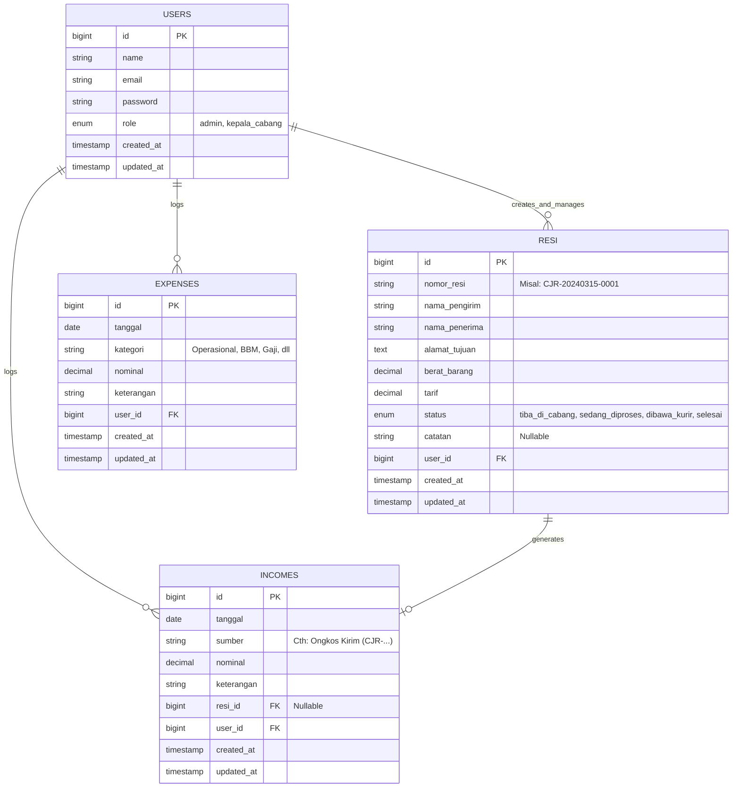
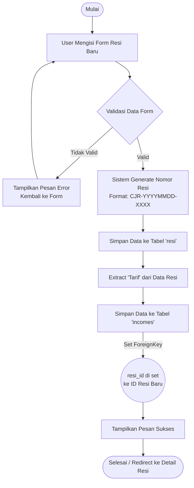

# In-TrackFin: Panduan & Dokumentasi Aplikasi

## 1. Deskripsi Aplikasi

**In-TrackFin** adalah platform operasional internal (Admin & Kepala Cabang) terintegrasi berbasis web yang dikembangkan khusus untuk memfasilitasi kebutuhan administrasi **PT Indah Logistik (Cabang Cianjur)**. 

Aplikasi ini bertujuan untuk menyederhanakan dua fungsi utama dalam satu pintu, yaitu:
1. **Shipment Tracking (Sistem Resi & Pengiriman):** Memonitor dan mengelola siklus pengiriman barang mulai dari paket diterima di cabang, proses pengiriman, hingga paket selesai dikirim.
2. **Financial Management (Manajemen Keuangan Cabang):** Mencatat seluruh arus kas masuk (pemasukan yang berkaitan langsung dengan resi pengiriman maupun sumber lainnya) serta arus kas keluar (pengeluaran operasional cabang seperti BBM, Gaji, Peralatan, dll).

Dengan antarmuka pengguna (UI) yang modern, estetik (menggunakan desain *Glassmorphism* dan *Dark Theme*), serta responsif, aplikasi ini memastikan staf cabang dapat memantau produktivitas logistik dan kesehatan finansial secara mulus (seamless) dalam satu panel Dashboard interaktif.

---

## 2. Struktur Hak Akses (Role-Based Access Control)

Aplikasi memiliki dua tingkatan *Role* (Peran) yang menentukan hak akses pengguna:
- **Admin Cabang (`admin`):** Staf operasional yang bertugas untuk meng-input data resi baru secara harian, mempembaharui status resi pengiriman, serta mencatat transaksi finansial rutin (pemasukan & pengeluaran).
- **Kepala Cabang (`kepala_cabang`):** Memiliki akses menyeluruh, lebih difokuskan pada pemantauan Dashboard secara makro, melihat statistik, serta melakukan audit/verifikasi pada menu Laporan Laba Rugi bulanan/tahunan.

---

## 3. Entity Relationship Diagram (ERD)

Struktur tabel utama dalam database saling berelasi untuk menciptakan integrasi finansial-ke-logistik otomatis (contoh: pembuatan resi memicu pencatatan pemasukan otomatis).

---

## 4. User Flow Utama (Alur Pengguna)

Berikut adalah alur navigasi dari awal hingga pengguna bisa mengakses fitur utama.

1. **Autentikasi:** Pengguna membuka aplikasi -> Halaman Login -> Memasukkan Email & Password -> Validasi Role -> Masuk ke Dashboard Utama.
2. **Dashboard:** Menampilkan kartu metrik harian (Total Resi, Total Pemasukan, Total Pengeluaran), grafik status pengiriman, dan rangkuman arus kas.
3. **Manajemen Resi (Operasional):** 
   - Klik menu *Tracking Resi* -> Klik *Tambah Resi* -> Input data paket & biaya -> Sistem menyimpan data Resi **DAN** otomatis membuat catatan *Pemasukan (Income)* terkait biaya ongkos kirim paket tersebut.
   - Status resi dapat di-update secara berkala (Misal: dari `Sedang Diproses` menjadi `Dibawa Kurir`).
4. **Manajemen Keuangan:** 
   - **Pengeluaran:** Klik menu *Pengeluaran* -> Klik *Tambah Pengeluaran* -> Pilih Kategori & Input Nominal pengeluaran harian cabang (Misal: Beli Bensin).
   - **Pemasukan:** Klik menu *Pemasukan* -> Pemasukan dari resi sudah ada otomatis, dan admin bisa menambah pemasukan manual untuk sumber lain.
5. **Pelaporan:** Klik menu *Laporan Laba Rugi (Reports)* -> Pilih rentang tanggal/bulan -> Sistem menyajikan selisih antara Pemasukan dan Pengeluaran, menilai apakah operasional cabang profit/defisit.
6. **Logout:** Klik tombol ikon *Logout* di menu profil sebelah kiri -> Sesi berakhir -> Kembali ke halaman Login.

---

## 5. Flowchart Sistem: Pembuatan Resi otomatis ke Pemasukan

Diagram ini menjelaskan alur logika di belakang layar (*backend*) ketika pengguna membuat Resi baru, di mana sistem secara cerdas langsung mengamankan catatan finansial.

